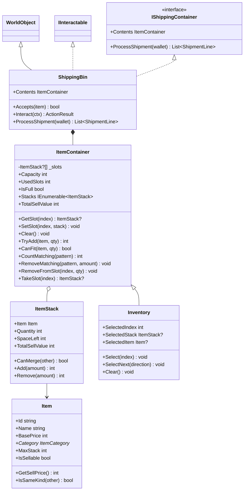
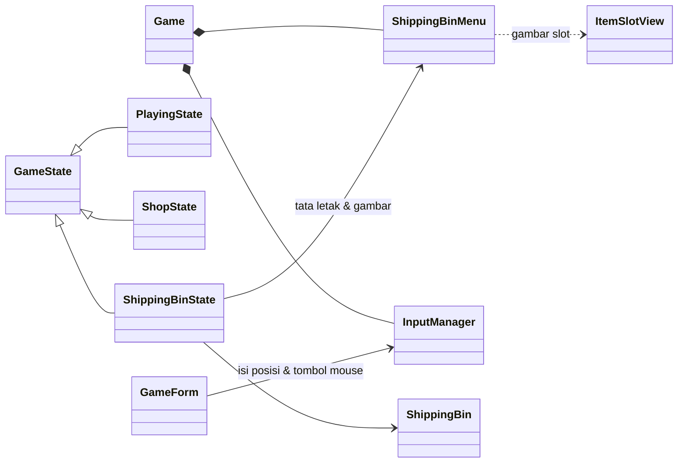

# Dokumentasi Sistem Inventory & Kotak Kirim

Dokumen ini menjelaskan sistem penyimpanan barang (inventory) dan penjualan lewat **kotak kirim**:
barang **dimasukkan dulu ke kotak**, baru **dijual otomatis saat tidur** — bukan langsung terjual saat ditekan X.

Isi dokumen:

1. Ringkasan & aturan main
2. Kontrol (mouse + keyboard)
3. Urutan belajar file
4. Class diagram
5. Alur lengkap
6. Aturan & kasus khusus
7. 4 pilar OOP & pola desain
8. Daftar file baru / berubah
9. Checklist uji manual

---

## 1. Ringkasan & aturan main

| Hal | Aturan |
|---|---|
| Cara menjual | Masukkan barang ke kotak kirim, lalu **tidur**. Tidak ada tombol "jual langsung". |
| Isi kotak | **36 slot** (6 x 6), otomatis menggabung barang sejenis. |
| Bisa ditarik kembali? | **Boleh**, selama belum tidur. Salah memasukkan barang tidak fatal. |
| Barang yang boleh masuk | Hanya `Item.IsSellable == true` (hasil panen, ikan, bahan, bibit, barang liar). Alat ditolak. |
| Harga | `Item.GetSellPrice()` per buah. Total kotak = jumlah `ItemStack.TotalSellValue`. |
| Kapan uang masuk | Saat `Game.EndDay` (tidur atau pingsan), lalu muncul di ringkasan malam. |
| Kalau kotak penuh | Barang yang tidak muat **tetap di tas**. Tidak ada barang hilang. |
| Kalau tas penuh saat menarik | Sisa barang **tetap di kotak**. Tidak ada barang hilang. |

Contoh alur singkat:

```
Panen parsnip -> X di kotak -> drag parsnip ke grid kanan -> tutup menu -> tidur
   -> ringkasan malam: "Parsnip x5 = 175 g" -> uang bertambah
```

---

## 2. Kontrol

### Di dunia (bermain biasa)

| Aksi | Mouse | Keyboard |
|---|---|---|
| Pilih slot toolbar | Klik kiri di slot toolbar | `1`..`=` atau roda mouse |
| Pakai alat | Klik kiri | `C` |
| Periksa / buka kotak / bicara | Klik kanan | `X` |
| Jalan | – | `WASD` / panah |

Klik di area toolbar **tidak** ikut memakai alat, jadi aman untuk mengganti slot.

### Di menu kotak kirim

| Aksi | Mouse | Keyboard |
|---|---|---|
| Ambil & geser barang | **Tahan klik kiri** di slot, lepas di slot tujuan | – |
| Pindah seluruh tumpukan | **Klik kanan** di slot (atau `Shift` + klik kiri) | `Shift` + `C` |
| Pindah 1 barang | – | `C` / `Enter` / `Spasi` |
| Pindah slot | Arahkan kursor (sorot biru) | `WASD` / panah |
| Ganti panel Tas <-> Kotak | – | `Q` / `E` |
| Lihat nama & harga barang | Arahkan kursor (tooltip) | Panel "Barang dipilih" |
| Tutup menu | – | `X` / `Esc` |

Saat menu terbuka, **jam berhenti** dan pemain tidak bisa berjalan.

### Di toko

| Aksi | Mouse | Keyboard |
|---|---|---|
| Pilih barang | Arahkan kursor (sorot biru) | `W` / `S` |
| Beli 1 | Klik kiri di baris | `C` / `Enter` / `Spasi` |
| Beli 5 | `Shift` + klik kiri | `Shift` + `C` |
| Keluar | Klik kanan | `X` / `Esc` |

---

## 3. Urutan belajar file

Dari yang paling sederhana ke yang memakai semuanya:

| No | File | Yang dipelajari |
|---|---|---|
| 1 | `Items/ItemStack.cs` | Satu tumpukan: jenis + jumlah, `Add`/`Remove` |
| 2 | `Items/ItemContainer.cs` | **Baru.** Wadah slot generik: gabung, kapasitas, ambil, taruh |
| 3 | `Items/Inventory.cs` | Turunan container + `SelectedIndex` untuk toolbar |
| 4 | `Interfaces/IShippingContainer.cs` | **Baru.** Kontrak "bisa menerima barang untuk dijual" |
| 5 | `World/Objects/ShippingBin.cs` | Kotak 36 slot + aturan hanya barang sellable + `ProcessShipment` |
| 6 | `Core/InputManager.cs` | Posisi mouse, tombol ditahan/ditekan/dilepas |
| 7 | `UI/GameForm.cs` | Mengubah koordinat mouse jendela -> koordinat game 960x576 |
| 8 | `UI/ItemSlotView.cs` | **Baru.** Menggambar satu slot (latar, ikon, jumlah, bar) |
| 9 | `UI/ShippingBinMenu.cs` | **Baru.** Tata letak grid, hover, tooltip, ikon yang di-drag |
| 10 | `Core/States/ShippingBinState.cs` | **Baru.** Aturan menu: drag & drop, klik kanan, keyboard |
| 11 | `Core/Game.cs` | Membuka menu + menjual **semua** kotak saat tidur |
| 12 | `Saving/SaveSystem.cs` | Simpan/muat isi kotak per slot |
| 13 | `Core/States/PlayingState.cs` | Klik toolbar = pilih slot |
| 14 | `Core/States/ShopState.cs` | Hover & klik baris toko |

---

## 4. Class diagram

### 4.1 Container & kotak kirim



### 4.2 Menu & input



Cara baca:

| Simbol | Arti |
|---|---|
| `<\|--` | mewarisi (inheritance) |
| `<\|..` | mengimplementasikan interface |
| `*--` | komposisi (dibuat & dimiliki penuh) |
| `-->` | asosiasi (menyimpan referensi) |
| `..>` | dependensi (hanya memakai) |

---

## 5. Alur lengkap

### 5.1 Buka kotak kirim

```
Pemain tekan X / klik kanan di depan kotak
  Player.Interact
    -> GameLocation.GetInteractableAt -> ShippingBin
       -> ShippingBin.Interact
          -> Services.OpenShippingBin(this)        (IGameServices)
             -> Game.ChangeState(new ShippingBinState(game, bin))
                -> Enter(): jam berhenti, pemain berhenti
```

Menu menampilkan dua grid:

```
+-------------------------- Kotak Kirim ---------------------------+
| Tas                     | Isi Kotak            0/36 slot         |
| [ ][ ][ ][ ][ ][ ]      | [ ][ ][ ][ ][ ][ ]                     |
| [ ][ ][ ][ ][ ][ ]      | [ ][ ][ ][ ][ ][ ]                     |
|                         | [ ][ ][ ][ ][ ][ ]                     |
| Barang dipilih          | [ ][ ][ ][ ][ ][ ]                     |
| ...                     | [ ][ ][ ][ ][ ][ ]                     |
| Perkiraan: 0 g          | [ ][ ][ ][ ][ ][ ]                     |
+-------------------------------------------------------------------+
```

### 5.2 Drag & drop (mouse)

```
Mouse down (kiri) di slot berisi
  -> TakeSlot(index)              // barang pindah ke "tangan" (state)
  -> gambar ikon mengikuti kursor

Mouse up (kiri)
  -> HitTest slot tujuan
     - di luar slot        -> ReturnStack ke slot asal
     - slot kosong         -> SetSlot
     - barang sama         -> Add (gabung), sisa kembali ke asal
     - barang beda         -> tukar posisi (swap)
     - tujuan kotak        -> cek IsSellable dulu; kalau tidak boleh, kembali ke asal
```

### 5.3 Klik kanan / Shift + klik (pindah semua)

```
QuickMove(slot)
  -> ambil seluruh tumpukan
  -> TryAdd ke panel seberang
  -> kalau tujuan penuh: sisa dikembalikan ke slot asal + pesan "Tas penuh"/"Kotak penuh"
```

### 5.4 Keyboard

```
Q / E      -> ganti panel fokus (Tas <-> Kotak)
WASD/panah -> pindah slot (baris & kolom, berputar di ujung)
C          -> pindah 1 barang
Shift + C  -> pindah seluruh tumpukan
X / Esc    -> tutup menu (kalau sedang drag, barang dikembalikan dulu)
```

### 5.5 Jual saat tidur

```
Kasur (X) -> RequestSleep -> DayEndState -> Game.EndDay
  1. ProcessAllShipments()
       untuk SETIAP lokasi, untuk SETIAP objek IShippingContainer:
         -> group isi per Item.Id
         -> wallet.Earn(total)
         -> Contents.Clear()
         -> ShipmentLine(name, quantity, total)
       gabungkan laporan yang namanya sama
  2. tanggal +1
  3. OnNewDay semua lokasi (tanaman tumbuh)
  4. energi pulih
  5. bangun di samping kasur
  6. surat pagi + simpan otomatis
  7. DaySummary -> Hud.DrawDaySummary
```

Karena memakai `IShippingContainer`, menambah kotak baru di lokasi lain **tidak perlu** mengubah `Game.EndDay`.

### 5.6 Simpan & muat

```
Simpan:
  untuk i = 0..35:
     stack = ShippingBin.Contents.GetSlot(i)
     kalau ada -> SaveData.ShippingBin.Add(SlotSave { Slot = i, Item, Quantity })

Muat:
  Contents.Clear()
  untuk setiap SlotSave:
     kalau slot tujuan kosong -> SetSlot(slot)
     kalau sudah terisi     -> TryAdd (fallback save lama)
```

Save lama (versi 1) menulis semua barang dengan `Slot = 0`. Fallback `TryAdd` membuat save lama tetap bisa dimuat tanpa kehilangan barang.

> Catatan: saat ini yang disimpan khusus baru kotak kirim di **Farm**. Interface `IShippingContainer`
> sudah membuat penjualan multi-kotak otomatis jalan; kalau nanti ada kotak di lokasi lain dan ingin
> isinya ikut tersimpan, tambahkan daftar kotak per lokasi di `SaveData`.

---

## 6. Aturan & kasus khusus

| Kasus | Hasil |
|---|---|
| Taruh alat (cangkul, kapasitas, pancing) ke kotak | Ditolak: "Cangkul tidak bisa dijual." |
| Taruh barang ke kotak saat 36 slot penuh | Barang tetap di tas, pesan "Kotak kirim penuh." |
| Tarik barang saat tas penuh | Sisa tetap di kotak, pesan "Tas penuh." |
| Drag ke slot berisi barang sama | Digabung sampai `MaxStack`; sisanya kembali ke asal |
| Drag ke slot berisi barang beda | Tukar posisi (swap) |
| Lepas drag di luar slot | Barang kembali ke slot asal |
| Tutup menu saat masih drag | Barang dikembalikan dulu, baru menu tertutup |
| Isi kotak 0 | Ringkasan malam menulis "(tidak ada)" |
| Banyak jenis barang | Ringkasan malam dibatasi 8 baris + "... dan N jenis lainnya" |
| Pingsan (02:00) | Tetap tidur, kotak tetap dijual |
| Dua kotak di lokasi berbeda | Keduanya dijual; laporan digabung per nama barang |

---

## 7. 4 pilar OOP & pola desain

| Pilar / Pola | Contoh di sistem ini |
|---|---|
| **Enkapsulasi** | Isi container hanya berubah lewat `TryAdd`, `TakeSlot`, `SetSlot`, `RemoveFromSlot`. `Inventory.SelectedIndex` hanya lewat `Select`/`SelectNext`. |
| **Pewarisan** | `Inventory -> ItemContainer`; `ShippingBinState -> GameState`; `ShippingBin -> WorldObject`. |
| **Polimorfisme** | `location.Objects.OfType<IShippingContainer>()` menjual kotak apa pun; `Item.GetSellPrice()` berbeda per jenis barang; `GameState.Update/Draw` berbeda per mode. |
| **Abstraksi** | `IShippingContainer` menyembunyikan cara menjual; `IGameServices.OpenShippingBin` membuat `ShippingBin` tidak kenal `Game`/`ShippingBinState`. |
| **State** | `PlayingState`, `ShopState`, `ShippingBinState` — game hanya memanggil state aktif. |
| **Template Method** | `Tool.Use` (tidak berubah) dan alur `EndDay` yang urutannya tetap. |
| **Data-driven** | Barang baru cukup ditambah di `ItemRegistry`/JSON; kotak tidak perlu diubah. |

Prinsip penting:

1. **Satu sumber aturan penyimpanan** — `ItemContainer`. Tas dan kotak tidak menduplikasi logika gabung/kapasitas.
2. **UI tidak tahu aturan game** — `ShippingBinMenu` hanya menggambar dan menghitung tata letak; keputusan pindah barang ada di `ShippingBinState`.
3. **Barang tidak pernah hilang** — setiap kegagalan mengembalikan barang ke asal.

---

## 8. Daftar file baru / berubah

### Baru

| File | Isi |
|---|---|
| `Items/ItemContainer.cs` | Wadah slot generik: kapasitas, gabung, ambil, taruh, nilai jual |
| `Interfaces/IShippingContainer.cs` | Kontrak kotak yang bisa dijual saat tidur |
| `Core/States/ShippingBinState.cs` | Logika menu kotak: drag & drop, klik kanan, keyboard |
| `UI/ShippingBinMenu.cs` | Tata letak grid, hover, tooltip, ikon drag |
| `UI/ItemSlotView.cs` | Menggambar satu slot barang |
| `DOKUMENTASI_INVENTORY.md` | Dokumen ini |

### Berubah

| File | Perubahan |
|---|---|
| `Items/Inventory.cs` | Sekarang `: ItemContainer`; hanya menyisakan pilihan slot toolbar |
| `World/Objects/ShippingBin.cs` | `Contents` jadi `ItemContainer` 36 slot; `Interacts` membuka menu; `Accepts`; `ProcessShipment` dari `Stacks` |
| `Core/GameConfig.cs` | `ShippingBinSize = 36` |
| `Interfaces/IGameServices.cs` | `OpenShippingBin(ShippingBin)` |
| `Core/Game.cs` | `ShippingBinMenu`, `OpenShippingBin`, `ProcessAllShipments` (semua lokasi), gabung laporan |
| `Core/InputManager.cs` | `MousePosition`, `IsMouseHeld`, `MouseDownPressed`, `MouseUpPressed` |
| `UI/GameForm.cs` | `OnMouseMove`/`OnMouseUp`, konversi koordinat jendela -> game |
| `Core/States/PlayingState.cs` | Klik toolbar = pilih slot, tidak memakai alat |
| `Core/States/ShopState.cs` | Hover baris + klik kiri membeli baris yang diklik |
| `UI/ShopMenu.cs` | `HitTestRow`, sorotan hover |
| `UI/Hud.cs` | `ToolbarSlotRect`/`ToolbarAreaRect`, ringkasan malam dibatasi 8 baris |
| `Saving/SaveSystem.cs` | Simpan/muat isi kotak per slot + fallback save lama |
| `Saving/SaveData.cs` | `Version = 2` |

---

## 9. Checklist uji manual

Jalankan `dotnet build`, lalu uji di game:

- [ ] X di kotak membuka menu; jam berhenti; pemain tidak bisa jalan.
- [ ] Drag 1 tumpukan dari tas ke kotak berhasil.
- [ ] Drag barang sejenis ke slot yang sudah berisi -> jumlah bertambah (gabung).
- [ ] Drag ke slot berisi barang lain -> tukar posisi.
- [ ] Drag ke luar slot -> barang kembali, tidak hilang.
- [ ] Klik kanan memindahkan seluruh tumpukan.
- [ ] `Shift` + klik kiri juga memindahkan seluruh tumpukan.
- [ ] Tarik barang dari kotak kembali ke tas berhasil.
- [ ] Alat tidak bisa dimasukkan (muncul pesan oranye).
- [ ] Isi sampai 36 slot; barang berikutnya tidak masuk dan tetap di tas.
- [ ] Tooltip menampilkan nama + harga saat kursor di atas barang.
- [ ] Tutup dengan X/Esc; buka lagi; isi kotak masih sama.
- [ ] Tidur -> ringkasan menampilkan barang, uang bertambah, kotak kosong.
- [ ] Simpan saat kotak berisi -> muat kembali -> isi & posisi slot benar.
- [ ] Muat save lama (versi 1) -> barang tidak hilang.
- [ ] Klik slot toolbar mengganti slot tanpa memakai alat.
- [ ] Di toko: hover menyorot baris; klik kiri membeli baris itu; klik kanan keluar.

---

## 10. Catatan desain (kenapa begini)

**Kenapa tidak langsung dijual saat X?**
Karena pemain perlu bisa memeriksa, mengatur, dan membatalkan. Menjual saat tidur juga membuat satu "momen ekonomi" per hari, sama seperti Stardew Valley.

**Kenapa `ItemContainer` terpisah dari `Inventory`?**
Tas dan kotak punya aturan penyimpanan yang sama. Dengan satu kelas induk, logika gabung/kapasitas hanya ditulis sekali dan tidak bisa berbeda diam-diam.

**Kenapa `IShippingContainer`?**
Supaya `Game.EndDay` tidak perlu tahu kotak mana yang ada di lokasi mana. Tambah peti penjualan di kota = cukup implementasikan interface, tanpa menyentuh `Game`.

**Kenapa mouse dan keyboard dua-duanya?**
Mouse nyaman untuk memindahkan banyak barang; keyboard tetap ada supaya game bisa dimainkan tanpa mouse dan untuk aksesibilitas.
