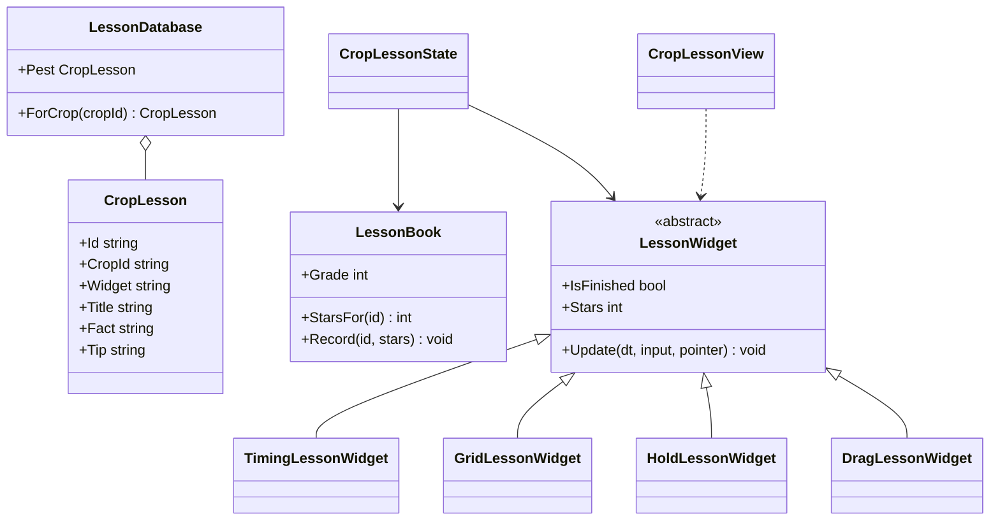

# Dokumentasi Minigame Tanaman & Hama

## Tujuan

Setiap tanaman punya cara panen berbeda. Pemain belajar lewat minigame pendek,
bukan lewat teks panjang saja. Minigame tutorial muncul satu kali per tanaman.
Minigame hama muncul setiap kali hama ditangani.

Lima tanaman utama:

| Tanaman | Minigame | Pelajaran |
|---|---|---|
| Tomat | `Hold`: tahan lalu lepas di zona hijau | Petik pelan supaya buah tidak pecah |
| Terong | `Grid`: pilih buah matang | Terong matang mengilap; yang kecil dibiarkan |
| Kentang | `Drag`: gali mengelilingi umbi | Umbi berada di tanah; jangan dicangkul dari tengah |
| Kale | `Grid order`: petik daun luar ke dalam | Pucuk disisakan agar tanaman tumbuh lagi |
| Jagung | `Timing`: tekan saat jarum di zona hijau | Tongkol dipatahkan saat matang |

Cabai belum dimasukkan ke data tanaman karena aset sprite belum tersedia.
Terong memakai pola buah yang sama: dipetik, lalu bisa berbuah ulang.

## Kontrol

| Aksi | Mouse | Keyboard |
|---|---|---|
| Mulai minigame | Klik kiri | `C` / `Enter` |
| Lewati tutorial | - | `Spasi` |
| Batalkan | - | `X` / `Esc` |
| Timing | Klik saat jarum di hijau | `C` saat jarum di hijau |
| Grid | Klik sel yang benar | Panah / WASD lalu `C` |
| Hold | Tahan klik, lepas di hijau | Tahan `C`, lepas di hijau |
| Drag | Tahan klik, putari jalur | Mouse diperlukan untuk minigame ini |
| Lanjut hasil | Klik/C | `C` / `Enter` |

## Alur panen

```text
X di tanaman siap panen
  -> HoeDirt validasi tanaman & tas
  -> Game.RunHarvestLesson(CropData, apply)
     -> belum pernah: buka CropLessonState
        -> lulus / lewati
        -> simpan bintang
        -> jalankan apply()
     -> sudah pernah: apply() langsung
  -> hasil masuk Inventory
```

`apply()` hanya dijalankan setelah minigame selesai. Jika pemain membatalkan,
tanaman tetap berada di tanah dan tidak ada hasil yang hilang.

## Bintang & Buku Tani

Setiap minigame memberi 1–3 bintang:

- 3 bintang: tanpa kesalahan
- 2 bintang: satu kesalahan
- 1 bintang: beberapa kesalahan atau bantuan otomatis
- 0 bintang: tutorial dilewati

Tekan `J`, lalu `Tab` untuk membuka **Buku Tani**. Klik baris atau tekan angka
untuk mengulang latihan. Latihan dari Buku Tani tidak mengubah kebun.

Tingkat total:

| Total bintang | Tingkat |
|---:|---|
| 0–5 | Tunas Baru |
| 6–9 | Bibit Harapan |
| 10–12 | Petani Muda |
| 13+ | Ahli Tani |

Mulai tingkat **Petani Muda**, panen mendapat bonus `+1` buah.
Tidak ada hukuman untuk bintang rendah.

## Hama

Hama muncul acak setiap pagi pada tanaman yang sudah tumbuh. Peluang dasar:
`GameConfig.PestChancePercent = 12` persen per petak per hari.

| Hama | Tanaman umum |
|---|---|
| Kutu daun | Tomat, terong |
| Bekicot | Kentang, kale, labu |
| Burung | Jagung |
| Jamur | Kembang kol |

Hama terlihat sebagai titik/serangga di atas tanaman. Tekan `X` untuk membuka
minigame **Tangkap Hama**. Klik semua hama, jangan klik daun tanaman.

Jika hama dibiarkan selama 2 hari:

- panen berikutnya berkurang `1` buah;
- tanaman tidak mati;
- hama tetap bisa ditangani setelah penalti aktif.

State hama disimpan di `ObjectSave`:

- `hazard`
- `hazardDays`
- `penalty`

## Tanaman berbuah ulang

`CropData.RegrowDays` mengatur tanaman yang tetap hidup setelah panen:

- Tomat: 3 hari
- Kale: 4 hari
- Jagung: 4 hari
- Terong: 3 hari
- Kentang, parsnip, kembang kol, labu: sekali panen

Tanaman berbuah ulang memakai `Crop.AfterHarvest()`. Tanaman sekali panen

## Struktur kode



File utama:

| File | Tanggung jawab |
|---|---|
| `Content/Data/lessons.json` | Judul, fakta, tip, dan parameter minigame |
| `Content/Data/crops.json` | `regrowDays` dan tipe hama per tanaman |
| `Farming/CropLesson.cs` | Data satu pelajaran |
| `Farming/LessonDatabase.cs` | Membaca dan memvalidasi JSON |
| `Farming/LessonBook.cs` | Bintang, tingkat, dan progres |
| `Farming/*LessonWidget.cs` | Logika minigame tanpa gambar |
| `Core/States/CropLessonState.cs` | Pause waktu, intro, bermain, hasil, batal |
| `UI/CropLessonView.cs` | Tampilan minigame |
| `World/Objects/HoeDirt.cs` | Pemicu panen, regrow, hama, penalti, save |
| `Saving/SaveData.cs` | Menyimpan bintang minigame |

## Cek manual

- [ ] Tomat membuka widget `Hold`, lulus membuat tomat masuk tas dan tanaman tetap hidup.
- [ ] Terong membuka widget `Grid`, panen kedua langsung tanpa tutorial.
- [ ] Kentang membuka widget `Drag`, tanaman hilang setelah panen.
- [ ] Kale meminta urutan daun luar ke dalam dan tetap hidup setelah panen.
- [ ] Jagung membuka widget `Timing`.
- [ ] `X` membatalkan minigame tanpa menghilangkan tanaman.
- [ ] `Spasi` melewati tutorial dan mencatat 0 bintang.
- [ ] Buku Tani menampilkan bintang dan bisa membuka latihan ulang.
- [ ] Hama muncul di tanaman; `X` membuka `pest_catch`.
- [ ] Hama yang dibiarkan 2 hari membuat panen berkurang 1 buah.
- [ ] Simpan/muat mempertahankan bintang dan status hama.
- [ ] Save lama tetap bisa dimuat karena field baru punya nilai default.
