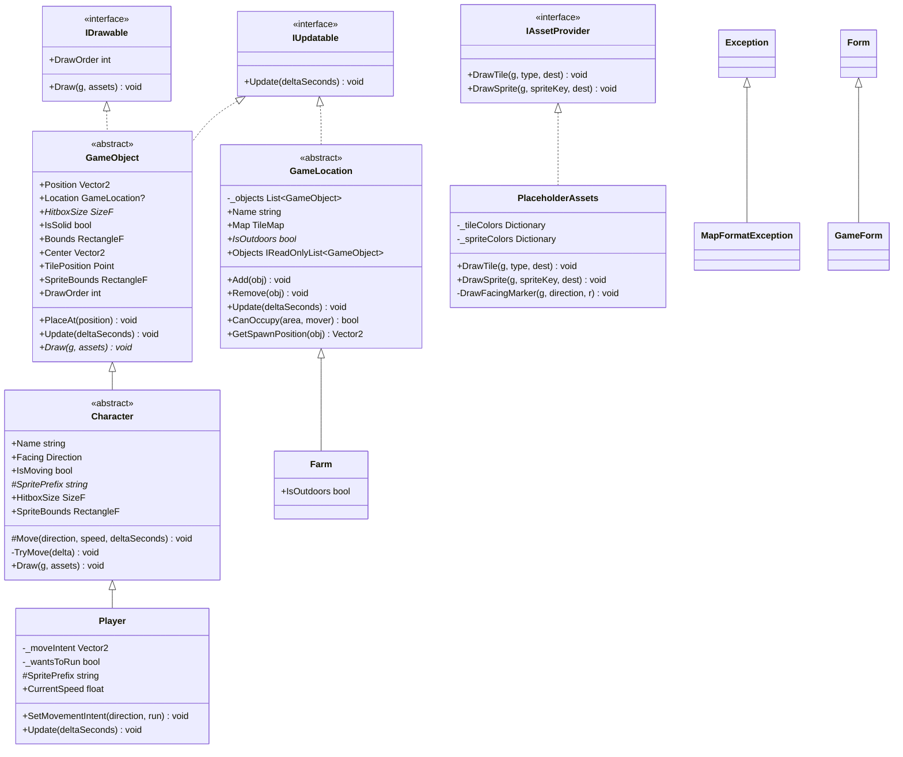
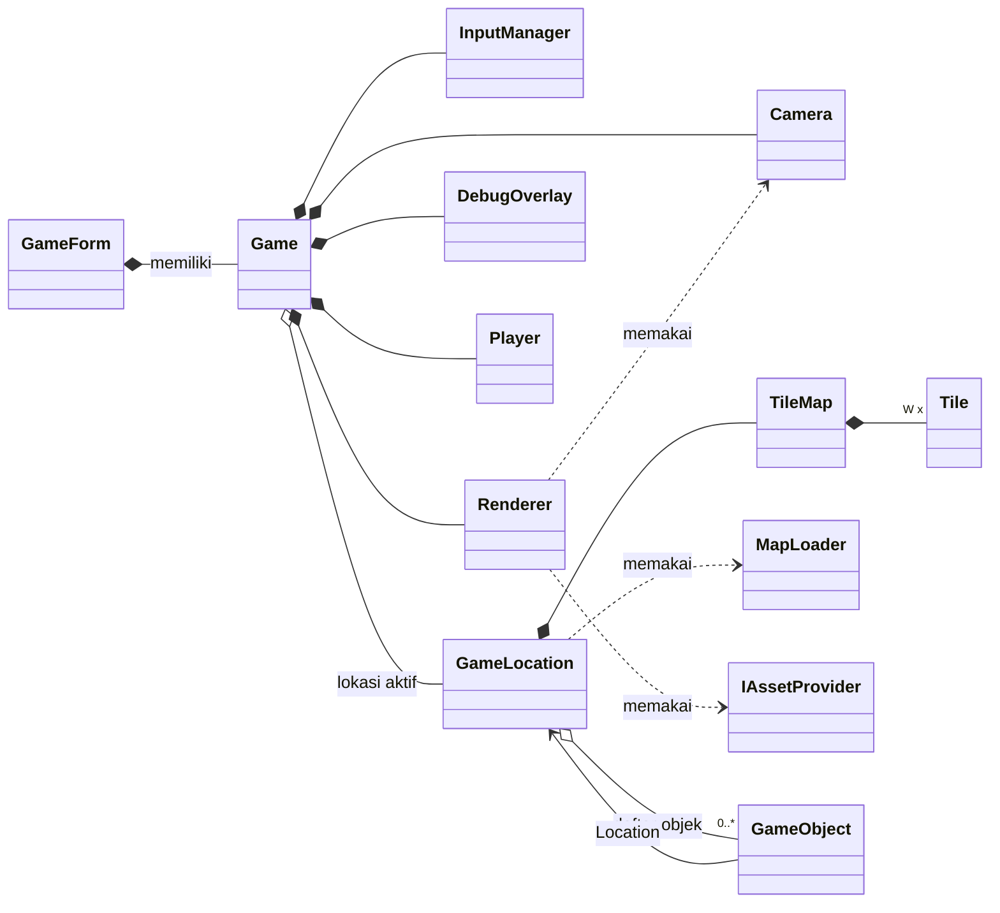

# FarmGame – MVP 0: Class Diagram & Fungsi

Dokumen ini menjelaskan semua class di MVP 0: urutan belajarnya, diagram hubungan antar class, dan fungsi tiap method.

---

## 1. Urutan Belajar (baca dari atas ke bawah)

Urutannya dari yang paling sederhana dan tidak bergantung ke class lain, lalu naik ke yang memakai semuanya.

| No | File | Kenapa dibaca di urutan ini | Konsep OOP yang dipelajari |
|---|---|---|---|
| 1 | `Program.cs` | Titik masuk aplikasi, dari sini semuanya dimulai | try–catch exception khusus |
| 2 | `Core/GameConfig.cs` | Semua angka (ukuran tile, skala, kecepatan) dipakai di mana-mana | static class, const |
| 3 | `Content/Maps/farm.txt` | Bentuk map-nya, supaya kebayang yang dibaca kode | – |
| 4 | `World/TileType.cs` | Jenis-jenis petak | enum |
| 5 | `World/Tile.cs` | Satu petak di map | **Enkapsulasi** (`private set`, `ChangeType`) |
| 6 | `World/MapFormatException.cs` | Error kalau map salah | **Pewarisan** dari `Exception` |
| 7 | `World/TileMap.cs` | Grid berisi Tile, cek bisa dilewati atau tidak | Komposisi (punya banyak `Tile`) |
| 8 | `World/MapLoader.cs` | Mengubah `farm.txt` jadi `TileMap` | static class, validasi |
| 9 | `Interfaces/IUpdatable.cs`, `Interfaces/IDrawable.cs` | Kontrak dasar semua benda | **Abstraksi** (interface) |
| 10 | `Entities/GameObject.cs` | Induk semua benda | **Abstraksi** (abstract class), virtual vs abstract |
| 11 | `Entities/Direction.cs` | Arah hadap | enum |
| 12 | `Entities/Character.cs` | Induk makhluk yang bisa bergerak + tabrakan | **Pewarisan**, `protected`, override |
| 13 | `Entities/Player.cs` | Karakter pemain | **Pewarisan** + **Polimorfisme** (override `Update`) |
| 14 | `World/GameLocation.cs` | Induk semua area, "wasit" tabrakan | abstract class, `IReadOnlyList` |
| 15 | `World/Locations/Farm.cs` | Contoh turunan lokasi, cuma beberapa baris | **Pewarisan** (manfaatnya kelihatan) |
| 16 | `Rendering/IAssetProvider.cs` | Kontrak "cara menggambar" | **Abstraksi** |
| 17 | `Rendering/PlaceholderAssets.cs` | Implementasi kotak warna | **Polimorfisme** (implementasi interface) |
| 18 | `Core/Camera.cs` | Bagian dunia yang terlihat | Enkapsulasi |
| 19 | `Rendering/Renderer.cs` | Urutan menggambar satu frame | **Polimorfisme** (`obj.Draw()`) |
| 20 | `Rendering/DebugOverlay.cs` | Info F3 | – |
| 21 | `Core/InputManager.cs` | Membaca keyboard | Enkapsulasi |
| 22 | `Core/Game.cs` | Merakit semua class, urutan Update & Draw | **Komposisi** |
| 23 | `UI/GameForm.cs` | Jendela + game loop | **Pewarisan** dari `Form`, override event |

> Tips: setelah selesai nomor 23, baca lagi bagian **4. Alur per Frame** di bawah sambil membuka `Game.cs`. Di situ semua class terlihat bekerja bersama.

---

## 2. Class Diagram

Bisa dilihat langsung di GitHub, VS Code (ekstensi *Markdown Preview Mermaid Support*), atau ditempel ke https://mermaid.live.

### 2.1 Pewarisan & interface (inti OOP)



Cara baca simbol:

| Simbol | Arti |
|---|---|
| `<\|--` garis penuh | **mewarisi** (inheritance), contoh: Player *adalah* Character |
| `<\|..` garis putus-putus | **mengimplementasikan** interface |
| `+` | public |
| `-` | private |
| `#` | protected (hanya class itu dan turunannya) |
| `*` di belakang | **abstract**, wajib di-override oleh turunan |

### 2.2 Relasi "memiliki" dan "memakai"



| Simbol | Arti | Contoh |
|---|---|---|
| `*--` | **komposisi**: dibuat dan dimiliki penuh | `Game` membuat `Camera` |
| `o--` | **agregasi**: dimiliki tapi bisa diganti | `Game` bisa ganti `GameLocation` |
| `..>` | **dependensi**: hanya memakai | `Renderer` memakai `IAssetProvider` |
| `-->` | **asosiasi**: menyimpan referensi | `GameObject.Location` |

---

## 3. Fungsi Tiap Class

### Program (`Program.cs`)
| Member | Fungsi |
|---|---|
| `Main()` | Menjalankan `GameForm`. Kalau map rusak, menangkap `MapFormatException` dan menampilkan pesan error. |

### GameConfig (`Core/GameConfig.cs`) – *static class*
| Member | Fungsi |
|---|---|
| `TileSize = 16` | Ukuran 1 tile dalam piksel logis |
| `Scale = 3` | Pembesaran ke layar (1 tile = 48 px di layar) |
| `ViewTilesX/Y`, `ViewWidth/Height` | Ukuran pandangan kamera (20×12 tile = 320×192) |
| `ScreenWidth/Height` | Ukuran jendela (960×576) |
| `TimerInterval` | Jeda timer game loop |
| `MaxDeltaSeconds` | Batas delta time (0,1 detik) |
| `PlayerWalkSpeed`, `PlayerRunSpeed` | Kecepatan jalan dan lari |
| `CameraFollowSpeed` | Seberapa cepat kamera mengejar pemain |
| `MapFolder` | Folder file map |

### TileType (`World/TileType.cs`) – *enum*
`Void, Grass, Dirt, Path, Water, Fence, Building`

### Tile (`World/Tile.cs`)
| Member | Fungsi |
|---|---|
| `X`, `Y` | Koordinat tile |
| `Type` | Jenis tile (`private set`, hanya bisa diubah lewat `ChangeType`) |
| `IsWalkable` | `true` kalau Grass, Dirt, atau Path |
| `ChangeType(newType)` | Mengubah jenis tile (nanti dipakai saat mencangkul) |

### MapFormatException (`World/MapFormatException.cs`) – *turunan `Exception`*
| Member | Fungsi |
|---|---|
| `MapFormatException(message)` | Membuat error dengan pesan yang jelas |

### TileMap (`World/TileMap.cs`)
| Member | Fungsi |
|---|---|
| `Width`, `Height` | Ukuran map dalam tile |
| `PixelWidth`, `PixelHeight` | Ukuran map dalam piksel logis |
| `SpawnTile` | Posisi huruf `S` |
| `IsInBounds(x, y)` | Cek koordinat ada di dalam map |
| `GetTile(x, y)` | Ambil tile, `null` kalau di luar map |
| `IsWalkable(x, y)` | Tile ini bisa dilewati? |
| `IsAreaWalkable(area)` | Semua tile yang disentuh hitbox bisa dilewati? |
| `WorldToTile(world)` *static* | Piksel ke indeks tile (`floor(px / 16)`) |
| `TileToWorld(x, y)` *static* | Indeks tile ke piksel |
| `Draw(g, assets, view)` | Gambar hanya tile yang terlihat kamera (culling) |

### MapLoader (`World/MapLoader.cs`) – *static class*
| Member | Fungsi |
|---|---|
| `LoadFromFile(path)` | Baca file map, validasi, lalu kembalikan `TileMap` |
| `CharToTile(c, ...)` *private* | Ubah huruf (G, D, P, …) jadi `TileType` |

Error yang dicek: file tidak ada, map kosong, panjang baris beda, huruf tidak dikenal, `S` tidak ada atau lebih dari satu.

### IUpdatable / IDrawable (`Interfaces/`) – *interface*
| Member | Fungsi |
|---|---|
| `Update(deltaSeconds)` | Dipanggil sekali per frame |
| `DrawOrder` | Urutan gambar (kecil = di belakang) |
| `Draw(g, assets)` | Menggambar diri sendiri |

### GameObject (`Entities/GameObject.cs`) – *abstract*
| Member | Fungsi |
|---|---|
| `Position` | Pojok kiri-atas hitbox (`protected set`) |
| `Location` | Lokasi tempat benda berada |
| `HitboxSize` *abstract* | Ukuran area tabrakan, **wajib** diisi turunan |
| `IsSolid` *virtual* | Menghalangi benda lain? Default `false` |
| `Bounds` | Kotak hitbox |
| `Center` | Titik tengah hitbox |
| `TilePosition` | Tile tempat benda berada |
| `SpriteBounds` *virtual* | Area gambar |
| `DrawOrder` | = bawah hitbox (Y-sorting) |
| `PlaceAt(position)` | Pindah langsung tanpa cek tabrakan |
| `Update(deltaSeconds)` *virtual* | Default kosong |
| `Draw(g, assets)` *abstract* | **Wajib** ditulis turunan |

### Direction (`Entities/Direction.cs`) – *enum*
`Up, Down, Left, Right`

### Character (`Entities/Character.cs`) – *abstract, turunan `GameObject`*
| Member | Fungsi |
|---|---|
| `Name` | Nama karakter |
| `Facing` | Arah hadap |
| `IsMoving` | Sedang bergerak? (`private set`) |
| `SpritePrefix` *abstract* | Awalan nama sprite, contoh `"player"` |
| `HitboxSize` *override* | 12×8 (area kaki) |
| `SpriteBounds` *override* | 16×28, berdiri di atas hitbox |
| `Move(direction, speed, dt)` *protected* | Gerak + ubah arah hadap + cek tabrakan per sumbu X lalu Y |
| `TryMove(delta)` *private* | Coba langkah penuh; kalau nabrak coba ½, ¼, … supaya merapat ke dinding |
| `Draw(g, assets)` *override* | Gambar sprite `"{prefix}_{arah}"` |

### Player (`Entities/Player.cs`) – *turunan `Character`*
| Member | Fungsi |
|---|---|
| `_moveIntent`, `_wantsToRun` *private* | Niat gerak dari input |
| `SpritePrefix` *override* | `"player"` |
| `CurrentSpeed` | 64 (jalan) atau 96 (lari) |
| `SetMovementIntent(direction, run)` | Menerima niat gerak dari `Game` (Player tidak membaca keyboard sendiri) |
| `Update(dt)` *override* | Memanggil `Move(...)` warisan dari `Character` |

### GameLocation (`World/GameLocation.cs`) – *abstract*
| Member | Fungsi |
|---|---|
| `Name`, `Map` | Nama lokasi dan map-nya |
| `IsOutdoors` *abstract* | Luar ruangan? **Wajib** diisi turunan |
| `Objects` | Daftar objek (read-only dari luar) |
| `Add(obj)` / `Remove(obj)` | Tambah/hapus objek dan mengatur `obj.Location` |
| `Update(dt)` *virtual* | Update semua objek (polimorfisme) |
| `CanOccupy(area, mover)` | Wasit tabrakan: tile walkable dan tidak menabrak objek solid |
| `GetSpawnPosition(obj)` | Posisi supaya hitbox pas di tengah tile `S` |

### Farm (`World/Locations/Farm.cs`) – *turunan `GameLocation`*
| Member | Fungsi |
|---|---|
| `Farm()` | Memuat `farm.txt` lewat constructor induk |
| `IsOutdoors` *override* | `true` |

### IAssetProvider (`Rendering/IAssetProvider.cs`) – *interface*
| Member | Fungsi |
|---|---|
| `DrawTile(g, type, dest)` | Gambar satu tile |
| `DrawSprite(g, spriteKey, dest)` | Gambar sprite berdasarkan nama, contoh `"player_down"` |

### PlaceholderAssets (`Rendering/PlaceholderAssets.cs`) – *implementasi `IAssetProvider`*
| Member | Fungsi |
|---|---|
| `DrawTile(...)` | Kotak warna + garis tepi tipis |
| `DrawSprite(...)` | Kotak warna (magenta kalau nama tidak dikenal) |
| `DrawFacingMarker(...)` *private* | Kotak hitam kecil penanda arah hadap |

### Camera (`Core/Camera.cs`)
| Member | Fungsi |
|---|---|
| `Position` | Pojok kiri-atas pandangan (`private set`) |
| `ViewArea` | Kotak area yang terlihat |
| `Follow(target, dt)` | Mengejar target pelan-pelan (lerp) |
| `SnapTo(target)` | Langsung pindah ke target |
| `ClampTo(w, h)` | Tidak boleh keluar map; map kecil diletakkan di tengah |
| `ScreenToWorld(point)` | Posisi mouse ke posisi dunia (untuk MVP 1) |

### Renderer (`Rendering/Renderer.cs`)
| Member | Fungsi |
|---|---|
| `Render(g, location)` | Bersihkan layar → skala ×3 → geser kamera → gambar tile → gambar objek |
| `DrawObjects(g, location)` *private* | Ambil objek yang terlihat → urutkan Y → panggil `obj.Draw()` |

### DebugOverlay (`Rendering/DebugOverlay.cs`)
| Member | Fungsi |
|---|---|
| `IsVisible` | Tampil atau tidak |
| `Toggle()` | Nyalakan/matikan (F3) |
| `Draw(g, game)` | Gambar grid, hitbox, dan panel info |
| `DrawGridAndHitbox(...)` *private* | Garis grid + kotak merah hitbox |
| `DrawInfoPanel(...)` *private* | Teks FPS, lokasi, posisi, tile, arah |

### InputManager (`Core/InputManager.cs`)
| Member | Fungsi |
|---|---|
| `KeyDown(key)` / `KeyUp(key)` | Dipanggil `GameForm` saat tombol ditekan/dilepas |
| `ReleaseAll()` | Kosongkan tombol saat Alt+Tab |
| `IsHeld(key)` | Tombol sedang ditahan? |
| `WasPressed(key)` | Tombol baru ditekan di frame ini? |
| `EndFrame()` | Hapus status "baru ditekan" di akhir frame |
| `IsRunning` | Shift ditahan? |
| `GetMoveVector()` | Arah 8 arah dari WASD/panah, sudah dinormalkan |

### Game (`Core/Game.cs`)
| Member | Fungsi |
|---|---|
| `Input`, `Camera`, `Player`, `CurrentLocation`, `Fps` | Objek-objek utama yang dimiliki Game |
| `Game(assets)` | Membuat Renderer, Player, Farm, lalu menaruh player di spawn |
| `ChangeLocation(tujuan)` | Pindahkan player ke lokasi lain + atur kamera |
| `Update(dt)` | Urutan logika per frame (lihat bagian 4) |
| `Draw(g)` | Panggil Renderer, lalu DebugOverlay kalau aktif |
| `CountFps(dt)` *private* | Hitung frame per detik |

### GameForm (`UI/GameForm.cs`) – *turunan `Form`*
| Member | Fungsi |
|---|---|
| `GameForm()` | Atur jendela 960×576, double buffer, buat `Game` dan timer |
| `OnShown` *override* | Mulai timer setelah jendela tampil |
| `GameLoop()` *private* | Hitung delta time → `Game.Update` → `Invalidate` |
| `OnPaint` *override* | Panggil `Game.Draw` |
| `OnPaintBackground` *override* | Sengaja kosong (anti kedip) |
| `OnKeyDown` / `OnKeyUp` *override* | Teruskan tombol ke `InputManager` |
| `OnDeactivate` *override* | `ReleaseAll` saat jendela tidak fokus |
| `OnFormClosing` *override* | Hentikan timer |

---

## 4. Alur Program

### 4.1 Saat game dibuka
```
Program.Main
  └─ new GameForm()
       ├─ new PlaceholderAssets()
       └─ new Game(assets)
            ├─ new Renderer(assets, Camera)
            ├─ new Player("Petani")
            ├─ new Farm()  →  MapLoader.LoadFromFile("farm.txt")  →  TileMap
            └─ ChangeLocation(farm)  →  player ditaruh di tile 'S', kamera snap
  └─ GameForm.OnShown  →  timer mulai
```

### 4.2 Setiap frame (±60 kali per detik)
```
Timer.Tick → GameForm.GameLoop()
  1. hitung deltaSeconds (maks 0,1)
  2. Game.Update(dt)
       a. F3 baru ditekan? → DebugOverlay.Toggle()
       b. Player.SetMovementIntent(Input.GetMoveVector(), Input.IsRunning)
       c. Farm.Update(dt)  →  Player.Update(dt)  →  Character.Move()
                                                     └─ TryMove → GameLocation.CanOccupy → TileMap.IsAreaWalkable
       d. Camera.Follow(player) lalu Camera.ClampTo(map)
       e. Input.EndFrame()
  3. Invalidate()  →  GameForm.OnPaint  →  Game.Draw(g)
       ├─ Renderer.Render: TileMap.Draw → urutkan objek → obj.Draw()
       └─ DebugOverlay.Draw (kalau F3 aktif)
```

---

## 5. Ringkasan 4 Pilar OOP

| Pilar | Contoh di kode |
|---|---|
| **Enkapsulasi** | `Tile.Type` (`private set` + `ChangeType`), `Player._moveIntent` (private, diubah lewat `SetMovementIntent`), `GameLocation._objects` (luar hanya dapat `IReadOnlyList`), `Camera.Position` (`private set`) |
| **Pewarisan** | `Player → Character → GameObject`, `Farm → GameLocation`, `MapFormatException → Exception`, `GameForm → Form` |
| **Polimorfisme** | `obj.Draw()` di Renderer, `obj.Update()` di GameLocation, override `SpritePrefix`, `HitboxSize`, `IsOutdoors`, `OnPaint` |
| **Abstraksi** | abstract class `GameObject`, `Character`, `GameLocation`; interface `IUpdatable`, `IDrawable`, `IAssetProvider` |
