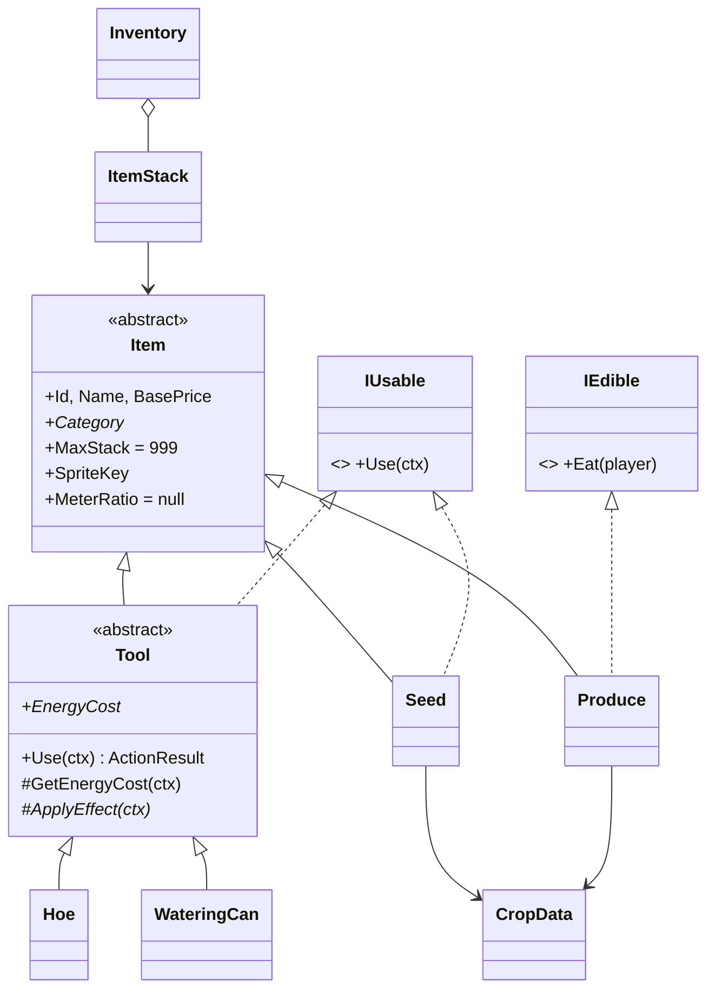
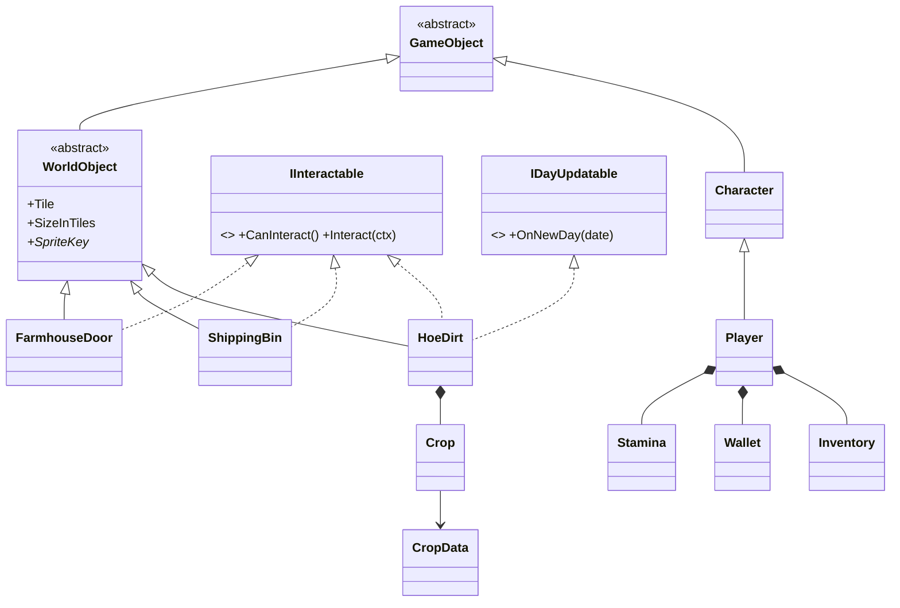
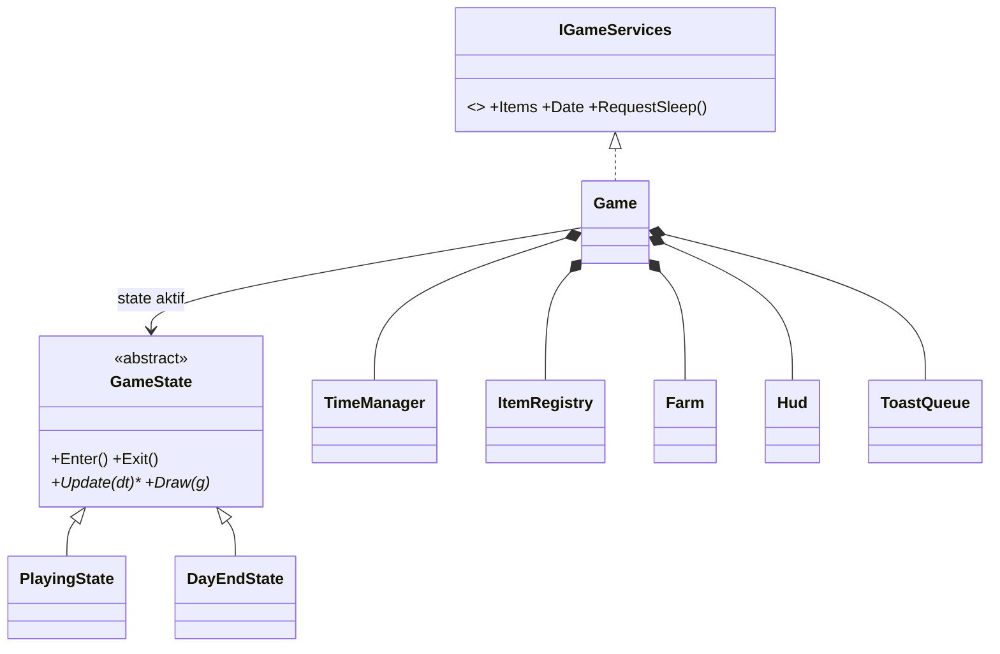

# Dokumentasi MVP 1 — Bertani

MVP 1 menambah: tas/toolbar, cangkul, penyiram, bibit, tanaman tumbuh per hari, jam & kalender,
energi, kotak kirim (jual malam hari), tidur lewat pintu rumah, HUD, dan pesan singkat (toast).

> **Catatan versi terbaru:** kotak kirim sekarang dibuka dengan menu (tas <-> kotak, 36 slot,
> drag & drop mouse, bisa ditarik kembali sebelum tidur). Lihat `DOKUMENTASI_INVENTORY.md`.
> Dokumen MVP 1 di bawah tetap menjelaskan versi awalnya.

## Kontrol

| Tombol | Fungsi |
|---|---|
| WASD / panah, Shift | Jalan, lari |
| 1–9, 0, -, = / roda mouse | Pilih slot toolbar |
| **C** / klik kiri | Pakai item ke tile di depan (cangkul, siram, tanam) |
| **X** / klik kanan | Periksa: panen, masukkan ke kotak kirim, pintu = tidur, atau makan |
| Enter / Spasi | Lanjut di layar ringkasan |
| F3 | Debug (kotak kuning = tile sasaran) |
| F4 / F6 (saat F3) | +5 semua bibit / +1 jam |

## Urutan belajar (baca file sesuai nomor)

**A. Kontrak (interface) — "apa yang bisa dilakukan"**
1. `Interfaces/ActionResult.cs` — hasil aksi: berhasil/gagal + pesan
2. `Interfaces/ActionContext.cs` — paket data aksi (siapa, di mana, tile mana)
3. `Interfaces/IGameServices.cs` — layanan game (buat item, tanggal, tidur)
4. `Interfaces/IUsable.cs`, `IInteractable.cs`, `IDayUpdatable.cs`, `IEdible.cs`

**B. Waktu**
5. `Systems/Season.cs`, `SleepReason.cs`
6. `Systems/GameDate.cs` — tanggal, `NextDay()`
7. `Systems/TimeManager.cs` — jam 06:00 → 02:00

**C. Data tanaman**
8. `Content/Data/crops.json` — data 4 tanaman
9. `Farming/CropData.cs` — 1 baris JSON = 1 objek
10. `Farming/Crop.cs` — tanaman yang sedang tumbuh
11. `Data/GameDataException.cs`, `Data/CropDatabase.cs` — baca + cek JSON

**D. Barang & tas**
12. `Items/ItemCategory.cs`, `Items/Item.cs` — induk semua barang (abstract)
13. `Items/ItemStack.cs`, `Items/Inventory.cs` — tumpukan & tas
14. `Items/Tool.cs` — induk alat (Template Method)
15. `Items/Hoe.cs`, `Items/WateringCan.cs` — alat konkret
16. `Items/Seed.cs`, `Items/Produce.cs` — bibit & hasil panen
17. `Data/ItemRegistry.cs` — pabrik item dari Id

**E. Komponen pemain**
18. `Entities/Components/Stamina.cs`, `Wallet.cs`
19. `Entities/Player.cs` — `FacingTile`, `UseSelectedItem`, `Interact`

**F. Benda di dunia**
20. `World/Objects/WorldObject.cs` — induk benda diam di grid
21. `World/Objects/HoeDirt.cs` — tanah dicangkul (punya Crop)
22. `World/Objects/ShipmentLine.cs`, `ShippingBin.cs` — kotak kirim
23. `World/Objects/FarmhouseDoor.cs` — pintu = tidur
24. `World/GameLocation.cs` (bagian baru: indeks tile, `OnNewDay`), `World/Locations/Farm.cs`

**G. Mode game & tampilan**
25. `Core/States/GameState.cs` → `PlayingState.cs` → `DayEndState.cs`
26. `Systems/DaySummary.cs`
27. `Core/Game.cs` — merakit semua + `EndDay`
28. `UI/Hud.cs`, `UI/ToastQueue.cs`, `Rendering/PlaceholderAssets.cs`, `Rendering/DebugOverlay.cs`
29. `Core/InputManager.cs`, `UI/GameForm.cs` (mouse)

## Class diagram

### Barang (Item)



### Benda dunia



### Mode game



## Alur

### Setiap frame
```
GameForm (timer) → Game.Update
  ├─ F3 → debug on/off
  ├─ _state.Update        ← PlayingState ATAU DayEndState
  └─ Input.EndFrame
GameForm.OnPaint → Game.Draw → _state.Draw
```

### PlayingState.Update
```
1. Pilih slot (angka / roda)
2. C → Player.UseSelectedItem   |  X → Player.Interact
       → hasil ActionResult → Toasts.Push(pesan)
3. Cheat F4/F6 (kalau F3)
4. Niat gerak
5. Jam jalan → kalau 02:00 → RequestSleep(PassedOut)
6. Dunia update, kamera, toast
```

### Tekan C (pakai item)
```
Player.UseSelectedItem
  └─ item terpilih IUsable?  → usable.Use(ctx)        (polimorfisme)
        Hoe        : tanah? kosong? → Location.Add(new HoeDirt)
        WateringCan: air? isi ulang : HoeDirt.Water()
        Seed       : HoeDirt kosong & musim cocok → dirt.Plant(new Crop)
  └─ berhasil → bibit -1 (kalau ConsumesOnUse), jeda 0,35 dtk
Tool.Use = cek energi → ApplyEffect → bayar energi kalau berhasil
```

### Tekan X (periksa)
```
Player.Interact
  1. Ada IInteractable di depan & CanInteract? → Interact
       HoeDirt      : panen / bersihkan tanaman mati
       ShippingBin  : buka menu kotak (versi baru; dulu: masukkan slot terpilih)
       FarmhouseDoor: RequestSleep → DayEndState
  2. Tidak ada → item terpilih IEdible? → makan
```

### Ganti hari (DayEndState)
```
FadeOut 0,8 dtk
  → Game.EndDay  (sekali):
       1. Kotak kirim dijual → uang masuk
       2. Tanggal +1
       3. Farm.OnNewDay → HoeDirt: tanaman tumbuh kalau disiram kemarin, tanah kering lagi
       4. Energi: 100% / 75% (tidur lewat 24:00) / 50% (pingsan)
       5. Pemain di depan pintu
  → Ringkasan (tunggu Enter / C)
  → FadeIn 0,8 dtk → PlayingState
```

## 4 pilar OOP di MVP 1

| Pilar | Contoh |
|---|---|
| **Encapsulation** | `Wallet.Gold`, `Stamina.Current`, `ItemStack.Quantity`, `WateringCan.WaterLeft`, `HoeDirt.Crop` semua `private set` — hanya berubah lewat method yang menjaga aturan |
| **Inheritance** | `Hoe → Tool → Item`, `HoeDirt → WorldObject → GameObject`, `DayEndState → GameState` |
| **Polymorphism** | `usable.Use(ctx)` (cangkul/siram/tanam), `target.Interact(ctx)` (panen/kirim/tidur), `_state.Update()`, `DrawOrder` override di HoeDirt |
| **Abstraction** | `Item`, `Tool`, `WorldObject`, `GameState` abstract; interface `IUsable`, `IInteractable`, `IEdible`, `IDayUpdatable`, `IGameServices` |

Pola tambahan: **Template Method** (`Tool.Use`), **Factory** (`ItemRegistry.Create`), **State** (`GameState`),
**Composition** (Player punya Inventory/Wallet/Stamina, HoeDirt punya Crop), **Data-driven** (`crops.json`).

## Beda dari dokumen (biar lebih simpel)

- Tetap pakai `float deltaSeconds`, bukan `GameTime`/`GameLoop`.
- Tidak ada enum `InputAction`; `InputManager` langsung punya `UseToolPressed`, `InteractPressed`, `GetPressedSlot()`.
- `record` diganti `class` biasa (`ActionResult`, `ActionContext`, `GameDate`, `CropData`, `DaySummary`, `ShipmentLine`).
- `ItemRegistry` pakai `if` biasa, bukan `Dictionary<string, Func<Item>>`.
- Pingsan dicek langsung di `PlayingState` (`Time.HasPassedOut`), bukan lewat event.
- `IDayUpdatable.OnNewDay(GameDate)` langsung terima tanggal (tidak ada `DayContext`; hujan nanti di MVP 2).
- Tidak ada `IDisposable`, `sealed`, event `Changed`.

## Grafis (Assets)

Semua sprite dibuat oleh `Tools/generate_assets.py` (Python + Pillow), pixel art 16px per tile.

```
python Tools/generate_assets.py     -> isi ulang folder Assets/
```

| Folder | Isi | Nama file = sprite key |
|---|---|---|
| `Assets/Tiles` | rumput (10 variasi), tanah, jalan, air (4 frame), pinggiran, pagar | `grass_3`, `water_2`, `edge_grass_n`, `fence_post` |
| `Assets/Characters` | petani 16×32, 4 arah × 5 frame (0 diam; 1 kaki maju, 2 melintas, 3 kaki lain maju, 4 melintas) | `player_down_2` |
| `Assets/Objects` | rumah, pintu, kotak kirim, tanah dicangkul (16 bentuk sambungan) | `house`, `bin`, `hoedirt_wet_5` |
| `Assets/Nature` | pohon & rumput & bunga (3 frame goyang), semak, batu, teratai, kupu-kupu | `tree_1`, `flowers_2_0`, `butterfly_0_1` |
| `Assets/Crops` | 4 tanaman × 5 tahap + mati | `crop_kale_3`, `crop_dead` |
| `Assets/Items` | ikon alat, bibit, hasil panen | `tool_hoe`, `seed_parsnip_seeds`, `produce_kale` |

Kelas `Rendering/SpriteAssets` (implementasi `IAssetProvider`) membaca PNG tersebut.
Ganti grafis = ganti 1 baris di `GameForm`: `new SpriteAssets()` ↔ `new PlaceholderAssets()` (**polimorfisme**).
Kalau PNG tidak ada, `SpriteAssets` otomatis pakai kotak warna placeholder.

`SpriteAssets.DrawTile` melihat tile tetangga (autotile): rumput tumpah ke tepi tanah, tebing di tepi kolam, pagar menyambung.

### Map hidup (MVP 1 + grafis)

- `farm.txt` punya huruf hiasan: `T` pohon, `b` semak, `R` batu, `g` rumput liar, `*` bunga, `L` teratai.
  `MapLoader` mencatatnya sebagai `MapMarker`, lalu `GameLocation.CreateScenery()` mengubahnya jadi objek.
- `Scenery` (abstract) → `Tree`, `Bush`, `Rock`, `GrassTuft`, `Flowers`, `LilyPad`.
  Turunan cukup mengisi `BaseKey`, `Sways`, `Variants` (**inheritance + polymorphism**).
  Goyangan dihitung dari jam + posisi X, jadi angin terlihat berjalan seperti gelombang.
- `Butterfly : GameObject` terbang acak (override `Update`).
- `HoeDirt.SpriteKey` melihat 4 tetangga (atas=1, kanan=2, bawah=4, kiri=8) → petak bersebelahan menyambung jadi satu bedeng.
- `DayLight` memberi warna langit sesuai jam: fajar keemasan, siang bening, senja oranye, malam biru.
