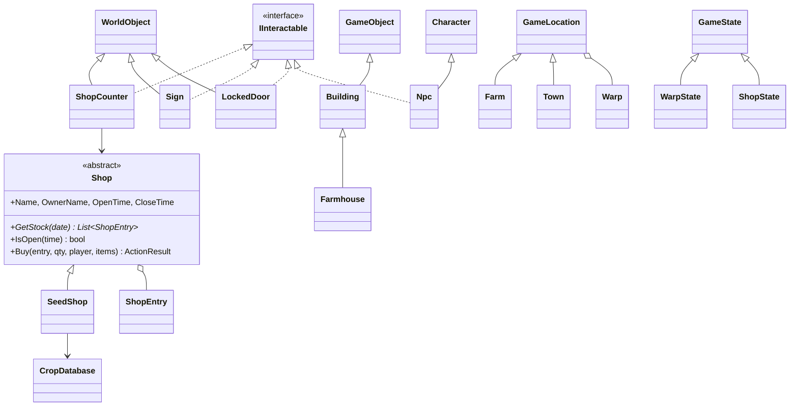

# Dokumentasi MVP 2 — Kota & Toko

MVP 2 menambah: map kota, pindah lokasi (warp) dengan layar gelap sebentar, toko bibit (jam buka 09:00–17:00),
penjual dan warga yang bisa diajak bicara, papan petunjuk, dan 4 tanaman baru untuk musim panas & gugur.

## Kontrol baru

| Tombol | Fungsi |
|---|---|
| Jalan ke ujung jalan di bawah kebun | Pindah ke kota (dan sebaliknya dari ujung atas kota) |
| **X** di depan meja toko | Buka toko (hanya 09:00–17:00) |
| W/S, roda mouse (di toko) | Pilih bibit |
| C / Enter / klik kiri (di toko) | Beli 1 — tahan **Shift** = beli 5 |
| X / Esc / klik kanan (di toko) | Keluar toko |
| **X** di depan warga / papan / pintu | Bicara / baca / ketuk |
| F5 (saat F3) | +500g untuk mencoba toko |
| Arahkan mouse ke baris toko | Menyorot baris (biru) |
| Klik kiri di baris toko | Pilih & beli baris itu (Shift = beli 5) |
| Klik kanan di toko | Keluar |

> Versi terbaru: menu toko juga bisa dipakai dengan mouse (hover + klik). Lihat `DOKUMENTASI_INVENTORY.md` bagian 2.

## Urutan belajar (file baru & yang berubah)

**A. Pindah lokasi**
1. `World/Warp.cs` — tile pemicu + nama lokasi tujuan + tile tujuan
2. `World/GameLocation.cs` — `AddWarp`, `GetWarpAt`, `AddBuilding` (cek huruf B), `GetInteractableAt`, `AddButterflies`
3. `Core/States/WarpState.cs` — gelap → pindah → terang
4. `Core/Game.cs` — daftar lokasi (`GetLocation`), `TryWarp`, `OpenShop`

**B. Kota**
5. `Content/Maps/town.txt` — map 40×30 (huruf `S` sekarang boleh tidak ada)
6. `World/Objects/Building.cs` — bangunan umum; `Farmhouse` sekarang turunannya
7. `World/Objects/LockedDoor.cs`, `Sign.cs` — pintu warga & papan petunjuk
8. `Entities/Npc.cs` — warga: diam atau jalan-jalan acak, menoleh & bicara saat di-X
9. `World/Locations/Town.cs` — merakit kota

**C. Toko**
10. `Shops/ShopEntry.cs` — satu baris barang
11. `Shops/Shop.cs` — induk toko: jam buka + aturan beli (abstract `GetStock`)
12. `Shops/SeedShop.cs` — isi toko dari `crops.json`, sesuai musim
13. `World/Objects/ShopCounter.cs` — meja toko → `Services.OpenShop`
14. `Items/Inventory.cs` — `CanFit` (cek muat sebelum bayar)
15. `Core/States/ShopState.cs`, `UI/ShopMenu.cs` — logika menu & gambar menu

## Class diagram



## Alur

### Pindah lokasi
```
PlayingState.Update (langkah terakhir) → Game.TryWarp
  └─ tile pemain ada Warp? → ChangeState(WarpState)
WarpState: gelap 0,25 dtk → Game.ChangeLocation(GetLocation(nama), tile) → terang 0,25 dtk → PlayingState
```
Farm (20,24) → Town (20,1) · Town (20,0) → Farm (20,23). Tile tujuan sengaja BUKAN tile warp, supaya tidak bolak-balik.

### Belanja
```
X di depan meja → Player.Interact → Location.GetInteractableAt → ShopCounter.Interact
  ├─ tutup? → pesan "tutup"
  └─ buka   → Services.OpenShop(shop) → ShopState (jam berhenti)
ShopState: C → Shop.Buy
  1. Inventory.CanFit?   tidak → "Tas penuh!"
  2. Wallet.TrySpend?    tidak → "Uangmu tidak cukup."
  3. Inventory.TryAdd → pesan "Beli ..."
```
Urutan cek tas dulu baru bayar = uang tidak pernah hilang sia-sia.

### Aksi yang mengganti mode
Pintu (tidur) dan meja (toko) mengganti state di TENGAH `PlayingState.Update`.
Karena itu `PlayingState` berhenti kalau `Game.CurrentState != this` (sebelumnya jam & gerak masih jalan 1 frame).

## 4 pilar OOP di MVP 2

| Pilar | Contoh |
|---|---|
| **Encapsulation** | `Shop.Buy` satu-satunya jalan beli; uang hanya lewat `Wallet.TrySpend`; warp & bangunan hanya lewat `AddWarp` / `AddBuilding` |
| **Inheritance** | `SeedShop → Shop`, `Npc → Character`, `Farmhouse → Building`, `Town → GameLocation`, `ShopState/WarpState → GameState` |
| **Polymorphism** | `GetInteractableAt` mengembalikan meja, papan, pintu, tanaman, ATAU warga — `Player.Interact` tidak peduli jenisnya; `shop.GetStock()` |
| **Abstraction** | `Shop` abstract; `IGameServices.OpenShop` — meja toko tidak kenal `Game` maupun `ShopState` |

## Tanaman baru

| Tanaman | Musim | Bibit | Jual | Hari |
|---|---|---|---|---|
| Tomat | Panas | 40 | 70 | 7 |
| Jagung | Panas + Gugur | 60 | 95 | 9 |
| Terong | Gugur | 30 | 55 | 5 |
| Labu | Gugur | 100 | 260 | 13 |

Cukup baris baru di `crops.json` — toko otomatis menjualnya di musim yang cocok. Musim dingin: toko kosong.

## Grafis baru

`python Tools/generate_assets.py` sekarang juga membuat:

| File | Isi |
|---|---|
| `Characters/npc_sari_*`, `npc_darto_*` | 2 warga (bentuk badan sama dengan petani, palet beda: `make_character(prefix, palet)`) |
| `Objects/house_red`, `house_blue` | rumah warga (`make_house(roof)`) |
| `Objects/shop`, `counter`, `sign` | toko bibit, meja toko, papan petunjuk |
| `Crops/crop_{tomato,corn,eggplant,pumpkin}_*`, `Items/...` | 4 tanaman baru: 5 tahap + ikon + bungkus bibit |
