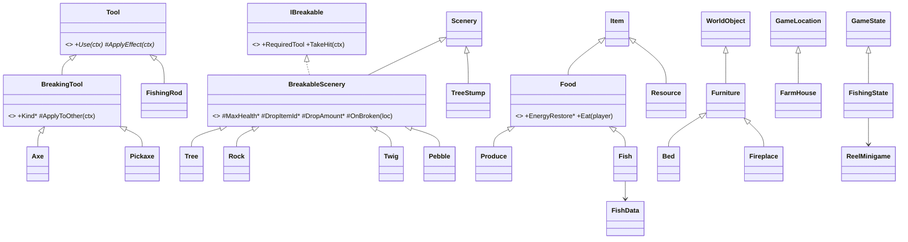

# Dokumentasi MVP 3 — Rumah, Kapak & Beliung, Memancing

MVP 3 menambah: dalam rumah (kasur = tidur, bangun di samping kasur), kapak & beliung untuk pohon, batu,
ranting, kerikil (dapat kayu & batu), tunggul pohon yang tumbuh lagi, pancing + minigame menarik ikan, 7 ikan.

## Kontrol baru

| Tombol | Fungsi |
|---|---|
| **X** di pintu rumah (kebun) | Masuk rumah |
| Injak keset di bawah (dalam rumah) | Keluar ke kebun |
| **X** di kasur | Tidur (pintu tidak lagi = tidur) |
| **C** + Kapak / Beliung | Pukul pohon, ranting / batu, kerikil. Beliung juga meratakan tanah dicangkul yang kosong |
| **C** + Pancing (menghadap air) | Lempar kail |
| **C** saat ada tanda **!** | Ikan menggigit → mulai minigame |
| **C** saat jarum di zona hijau | Tarik. 3x kena = dapat ikan, 3x meleset = senar putus |
| X / Esc (saat memancing) | Berhenti |

Barang awal: Cangkul, Penyiram, Kapak, Beliung, Pancing, 15 Bibit Parsnip.

## Urutan belajar (file baru & yang berubah)

**A. Dalam rumah**
1. `World/TileType.cs` (+`Floor`, `Wall`), `World/Tile.cs`, `World/MapLoader.cs` (`O` lantai, `X` dinding)
2. `Content/Maps/farmhouse.txt` — 12×9
3. `World/Objects/Furniture.cs` — `Furniture` (satu kelas untuk perabot biasa), `Bed` (X = tidur), `Fireplace` (api berkedip)
4. `World/Locations/FarmHouse.cs` — merakit rumah, warp keset → kebun
5. `World/Objects/FarmhouseDoor.cs` — X = `Services.WarpTo(FarmHouse)`
6. `Rendering/SpriteAssets.cs` — lantai bervariasi; dinding yang menghadap lantai = kertas dinding, lainnya kayu gelap

**B. Kapak & beliung**
7. `Interfaces/IBreakable.cs`, `Items/ToolKind.cs`
8. `Items/BreakingTool.cs` — induk Axe & Pickaxe (cari IBreakable yang cocok → pukul)
9. `Items/Axe.cs`, `Items/Pickaxe.cs` (`ApplyToOther`: ratakan HoeDirt kosong)
10. `World/Objects/BreakableScenery.cs` — nyawa + getar; `Tree`, `Rock`, `Twig`, `Pebble`, `TreeStump`
11. `World/MapMarker.cs` — huruf `w` ranting, `p` kerikil (tile di bawahnya tanah)
12. `Items/Resource.cs` — kayu & batu

**C. Memancing**
13. `Content/Data/fish.json`, `Fishing/FishData.cs`, `Data/FishDatabase.cs` (`PickRandom`: ikan susah lebih jarang)
14. `Data/JsonDataFile.cs` — aturan baca JSON yang dipakai bersama crops.json & fish.json
15. `Items/Food.cs` — induk `Produce` & `Fish` (cara makan ditulis sekali)
16. `Items/FishingRod.cs` → `Services.StartFishing`
17. `Fishing/ReelMinigame.cs` — aturan minigame saja (tanpa gambar)
18. `Core/States/FishingState.cs` — Waiting → Bite → Reeling
19. `UI/FishingView.cs`, `Core/Camera.cs` (`WorldToScreen`)

**D. Game**
20. `Core/Game.cs` — mulai di dalam rumah; `EndDay` memanggil `OnNewDay` untuk SEMUA lokasi; `WarpTo`, `StartFishing`;
    warna langit hanya di luar ruangan

## Class diagram



## Alur

### Tekan C dengan kapak / beliung
```
Tool.Use (cek energi → ApplyEffect → bayar energi)
  BreakingTool.ApplyEffect
    ├─ ada IBreakable di depan & RequiredTool == Kind → TakeHit
    │     nyawa -1, getar
    │     nyawa 0 → bahan masuk tas → OnBroken
    │                 Tree: diganti TreeStump (5 hari → Tree lagi)
    │                 lainnya: hilang
    └─ tidak ada → ApplyToOther (Pickaxe: ratakan HoeDirt kosong)
```
Pukulan terakhir dicek dulu: kalau bahannya tidak muat di tas → "Tas penuh!" dan benda tidak hancur.

### Memancing
```
C + Pancing menghadap air → FishingRod → Services.StartFishing → FishingState
  Enter  : jam berhenti, pilih ikan (musim ini, ikan susah lebih jarang)
  Waiting: 1,5–4 dtk. Tekan C sekarang = "Terlalu cepat"
  Bite   : tanda ! selama 1 dtk. Tekan C → Reeling. Telat = lepas
  Reeling: ReelMinigame
             jarum bolak-balik di bar, zona hijau acak
             C di zona = kena (zona pindah), di luar = meleset
             3 kena = ikan masuk tas, 3 meleset = putus
             difficulty ↑ = jarum lebih cepat, zona lebih sempit
```

### Ganti hari
```
Kasur (X) → RequestSleep → DayEndState → Game.EndDay
  1. jual isi SEMUA kotak kirim (IShippingContainer)   2. tanggal +1
  3. OnNewDay untuk SEMUA lokasi (tanaman, tunggul di kebun & kota)
  4. energi pulih           5. bangun di samping kasur
```

## 4 pilar OOP di MVP 3

| Pilar | Contoh |
|---|---|
| **Encapsulation** | Nyawa pohon/batu (`_health`) hanya berubah lewat `TakeHit`; minigame hanya berubah lewat `Update` & `Press` |
| **Inheritance** | `Axe → BreakingTool → Tool → Item`, `Tree → BreakableScenery → Scenery`, `Fish → Food → Item`, `Bed → Furniture` |
| **Polymorphism** | `target.TakeHit()` untuk pohon/batu/ranting/kerikil; `OnBroken` beda di `Tree`; `ApplyToOther` beda di `Pickaxe`; `food.Eat()` untuk sayur & ikan |
| **Abstraction** | `IBreakable`, `BreakingTool`, `BreakableScenery`, `Food` abstract; `ReelMinigame` aturan tanpa gambar, `FishingView` gambar tanpa aturan |

## Ikan

| Ikan | Musim | Jual | Difficulty |
|---|---|---|---|
| Ikan Mas | Semi, Panas, Gugur | 30 | 1 |
| Mujair | Dingin, Semi | 35 | 1 |
| Nila | Semi, Panas | 45 | 2 |
| Lele | Semi, Gugur, Dingin | 65 | 3 |
| Gurame | Panas, Gugur | 90 | 3 |
| Belut | Gugur, Dingin | 110 | 4 |
| Ikan Gabus | Panas, Dingin | 150 | 5 |

## Grafis baru

`python Tools/generate_assets.py` sekarang juga membuat:

| File | Isi |
|---|---|
| `Tiles/floor_0..3`, `wall_front`, `wall_top` | lantai kayu, dinding dalam rumah |
| `Objects/bed`, `table`, `plant`, `rug`, `doormat`, `window`, `fireplace_0/1` | perabot |
| `Nature/stump`, `twig_0/1`, `pebble_0/1` | tunggul, ranting, kerikil |
| `Items/tool_axe`, `tool_pickaxe`, `tool_fishing_rod`, `resource_wood`, `resource_stone` | alat & bahan |
| `Items/fish_*` | 7 ikan (2 bentuk badan: lebar & panjang, palet beda) |
