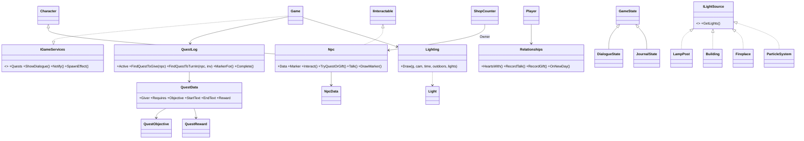

# Dokumentasi MVP 4 — Cerita, Quest, Warga & Cahaya

MVP 4 menambah: cerita (surat Kakek Wiryo), 7 quest berantai dengan tanda **!** / **?** di atas kepala warga,
kotak dialog dengan efek mesin tik dan wajah pembicara, pertemanan (hati) + hadiah, jurnal (J),
warga baru Raka, dan perombakan grafis: cahaya malam (lampu, jendela, perapian, kunang-kunang),
bayangan bangunan, partikel saat memakai alat, bingkai UI kayu, warna lebih kaya.

## Kontrol baru

| Tombol | Fungsi |
|---|---|
| **X** di depan warga | Bicara / terima quest / serahkan quest / beri hadiah |
| **X** di meja toko | Kalau Bu Sari punya quest → quest dulu; kalau tidak → buka toko |
| **C / X / Enter / Spasi** saat dialog | Tampilkan semua teks → halaman berikutnya → tutup |
| **J** | Buka / tutup jurnal (quest aktif + hati pertemanan) |

## Cerita

Kakek Wiryo meninggalkan kebunnya untukmu. Hari pertama dimulai dengan suratnya. Quest:

| # | Quest | Dari → Ke | Tujuan | Hadiah |
|---|---|---|---|---|
| 1 | Surat dari Kakek | otomatis → Pak Darto | Bicara dengan Pak Darto | 100g |
| 2 | Panen Pertama | Pak Darto | 5 Parsnip | 250g + 10 bibit kentang |
| 3 | Kayu untuk Kios | Bu Sari | 20 Kayu | 200g + 5 bibit kale |
| 4 | Anak di Tepi Kolam | Pak Darto → Raka | Bicara dengan Raka | 50g |
| 5 | Tantangan Pemancing | Raka | 3 ikan apa saja | 300g |
| 6 | Sumur Desa | Pak Darto (setelah 3 & 5) | 25 Batu | 500g |
| 7 | Mimpi Kakek | Pak Darto | 1 Kembang Kol | 1000g + 5 bibit labu |

Tanda di atas kepala: **!** kuning = ada quest baru, **?** biru = quest bisa diserahkan (syarat sudah terpenuhi).

## Pertemanan & hadiah

- Bicara pertama setiap hari: +10 poin. 100 poin = 1 hati, maksimal 10 hati.
- Pegang hasil panen / ikan / bahan, lalu **X** di depan warga = hadiah (1x per warga per hari).
  Suka sekali +80, suka +45, biasa +20, benci −40. Selera ada di `npcs.json`.
- Mulai 3 hati, warga kadang mengucapkan kalimat khusus (`heartLines`).

## Urutan belajar (file baru & yang berubah)

**A. Data cerita (tanpa kode!)**
1. `Content/Data/npcs.json` — warga: nama, peran, kalimat harian, kalimat akrab, selera hadiah
2. `Content/Data/quests.json` — quest: pemberi, syarat, tujuan (`talk` / `bring`), teks pembuka & penutup, hadiah
3. `Social/NpcData.cs` (+`GiftTaste`), `Data/NpcDatabase.cs`
4. `Quests/QuestData.cs` — `QuestData`, `QuestObjective`, `QuestReward`
5. `Items/Item.cs` (`Matches`: id atau `"category:fish"`), `Items/Inventory.cs` (`CountMatching`, `RemoveMatching`)

**B. Aturan**
6. `Quests/QuestLog.cs` — quest aktif/selesai, `FindQuestToGive`, `FindQuestToTurnIn`, `MarkerFor`, `Complete`, `Validate`
7. `Social/Relationships.cs` — poin, hati, sudah disapa / diberi hadiah hari ini
8. `Entities/Npc.cs` — urutan saat diajak bicara: serahkan quest → quest baru → hadiah → ngobrol
9. `World/Objects/ShopCounter.cs` — meneruskan quest ke penjual (`Owner`)

**C. Dialog & jurnal**
10. `Interfaces/IGameServices.cs` — `Quests`, `ShowDialogue`, `Notify`, `SpawnEffect`
11. `Core/States/DialogueState.cs` — efek mesin tik, halaman, `onFinished`
12. `UI/UiPanel.cs` — bingkai kayu yang dipakai semua UI
13. `UI/DialogueBox.cs`, `UI/JournalMenu.cs`, `Core/States/JournalState.cs`, `UI/Hud.cs` (pelacak quest kiri atas)

**D. Cahaya & efek**
14. `Rendering/Light.cs`, `Interfaces/ILightSource.cs`
15. `World/Objects/LampPost.cs`, `World/Objects/Building.cs` (jendela menyala + bayangan), `Fireplace`
16. `Rendering/Lighting.cs` — menggantikan `DayLight`: warna udara per jam + peta cahaya + pendar (bloom)
17. `Rendering/Particles.cs` — serpihan alat, kunang-kunang (juga `ILightSource`)
18. `Rendering/Vignette.cs`, `Rendering/Renderer.cs` (lapisan bayangan, partikel, `RenderOverlays`)
19. `Items/Tool.cs` — langkah ke-4 Template Method: `GetUseEffect` (tiap alat memilih partikelnya)

**E. Game**
20. `Core/Game.cs` — surat pembuka, `UpdateWorldExtras` (tanda quest + partikel), `CollectLights`, urutan gambar

## Class diagram



## Alur

### X di depan warga
```
Player.Interact → Npc.Interact
  1. QuestLog.FindQuestToTurnIn  → ada? Complete (ambil barang, beri hadiah)
                                   → dialog EndText → toast "Quest selesai"
                                   → quest otomatis + quest berikutnya dari warga ini
  2. QuestLog.FindQuestToGive    → ada? dialog StartText → setelah ditutup: Quest.Start
  3. pegang Food/Resource & belum memberi hari ini → hadiah (poin sesuai selera)
  4. ngobrol biasa (+10 poin sekali sehari)
```

### Tanda ! / ?
```
PlayingState.Update → Game.UpdateWorldExtras
  setiap Npc di lokasi ini: npc.Marker = QuestLog.MarkerFor(id, tas)
Game.DrawWorldAndHud: Render → Lighting → RenderOverlays (tanda) → Vignette → HUD
  (tanda digambar SETELAH cahaya, jadi tetap terang di malam hari)
```

### Cahaya
```
Lighting.Draw
  warna udara = campuran 2 titik waktu terdekat (fajar, siang, senja, malam, larut)
  kurang gelap → cukup warnai layar
  gelap → peta cahaya 320x192: tiap Light mengurangi gelap (lembut di pinggir) + warna hangat
        → diperbesar 3x halus → pendar bulat di atas lampu yang kuat
```

## 4 pilar OOP di MVP 4

| Pilar | Contoh |
|---|---|
| **Encapsulation** | Daftar quest aktif/selesai hanya berubah lewat `QuestLog.Start` & `Complete`; poin pertemanan hanya lewat `Relationships` (selalu 0..1000) |
| **Inheritance** | `Npc → Character → GameObject`; `DialogueState`, `JournalState → GameState`; `LampPost → WorldObject` |
| **Polymorphism** | `ILightSource.GetLights()` untuk lampu, jendela, api, kunang-kunang — `Game.CollectLights` tidak peduli jenisnya; `Tool.GetUseEffect()` beda per alat; `GameObject.DrawShadow()` hanya ditimpa `Building` |
| **Abstraction** | Warga & item hanya mengenal `IGameServices.ShowDialogue / Quests`, bukan `Game`; `QuestLog` aturan tanpa gambar, `JournalMenu` gambar tanpa aturan |

Pola: **data-driven** (quest & warga baru = tambah JSON), **State** (dialog & jurnal), **Template Method** (`Tool.Use` langkah ke-4).

## Grafis

`python Tools/generate_assets.py` sekarang:

- **Volume** (`volume_shade`): semua objek, alam, karakter, tanaman diberi cahaya dari kiri-atas —
  pinggir kiri/atas lebih terang & hangat, pinggir kanan/bawah lebih gelap (ke ungu tua, bukan hitam).
  Benda rata (`hoedirt`, `rug`, `doormat`, `lily`) dilewati.
- **Warna** (`grade`): semua gambar +15% saturasi, +5% kontras, sedikit lebih hangat.
- Gambar baru:

| File | Isi |
|---|---|
| `Objects/lamppost` | tiang lampu besi + lentera |
| `UI/marker_new`, `UI/marker_turnin` | tanda **!** kuning, **?** biru |
| `UI/heart_full`, `UI/heart_empty` | hati pertemanan |
| `Characters/npc_raka_*` | Raka, pemancing muda (topi hijau, kaus biru) |

Di game: bayangan bangunan jatuh ke kanan-bawah (searah cahaya gambar), lampu & jendela menyala mulai senja,
kunang-kunang setelah 19:30, partikel saat mencangkul/menyiram/menebang/memecah batu/panen/memancing,
vignette tipis di tepi layar, semua panel UI berbingkai kayu.
